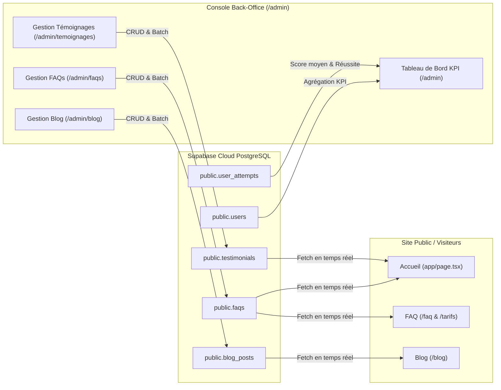

# Brand & Design Canvas — Admin Real-Time Synchronization & Batch Actions UI

**Version :** 1.0  
**Statut :** Approuvé pour Implémentation  
**Projet :** Super4C2 Enterprise  
**Objectif :** Éliminer l'écart entre les données publiques (visiteurs) et la console de direction (admin), et transformer les tableaux de gestion en un système interactif haut de gamme (Fintech / EdTech moderne) équipé d'actions groupées (Batch Actions).

---

## 1. Direction Visuelle & Tonalité

### 1.1 Tonalité de Marque
- **Autorité & Sérénité Institutionnelle :** Une console de direction digne des plus grands centres d'examen internationaux (France Éducation International, Cambridge Assessment).
- **Zéro Fiction, 100% Données Réelles :** Chaque compteur, pastille de statut et graphique reflète fidèlement la base de données PostgreSQL de production.
- **Efficacité Opérationnelle :** Réduire les frictions de modération grâce à la sélection multiple, aux actions en lot (batch actions) et à l'export instantané.

### 1.2 Palette de Couleurs Spécifique (Console Direction)

| Rôle Visuel | Token / Valeur HSL | Code HEX | Usage UI |
| :--- | :--- | :--- | :--- |
| **Fond Profond (Back-Office)** | `hsl(222, 47%, 6%)` | `#060B18` | Arrière-plan nocturne de la console administrative |
| **Surface Carte / Table** | `hsl(222, 47%, 9%)` | `#0C1222` | Conteneurs de tableaux, cartes de métriques KPI |
| **Bordure Subtile** | `rgba(255, 255, 255, 0.08)` | `#FFFFFF14` | Délimitation nette des lignes et cellules de tableau |
| **Accent Action / Érable** | `hsl(353, 80%, 50%)` | `#E51A31` | Boutons d'action prioritaires, badges d'alerte, sélection active |
| **Succès / Seuil Validé** | `hsl(158, 64%, 45%)` | `#10B981` | NCLC 7+, statut Actif / Publié, validation par lot |
| **Attention / Action Irréversible** | `hsl(38, 92%, 50%)` | `#F59E0B` | Dialogue de confirmation de suppression en lot |
| **Sélection Flottante (Batch Bar)**| `rgba(15, 23, 42, 0.85)` | `#0F172AD9` | Barre d'action flottante glassmorphique avec lueur néon |

---

## 2. Composants UI & Expérience des Actions Groupées (Batch Actions)

### 2.1 Barre d'Action Flottante (`AdminBatchActionBar`)
- **Positionnement :** Flottante, ancrée au bas de l'écran (`fixed bottom-6 left-1/2 -translate-x-1/2 z-50`), animée via Framer Motion avec entrée `spring` (slide up + fade in).
- **Contenu & Hiérarchie :**
  1. **Compteur Dynamique :** Pastille avec le nombre d'éléments sélectionnés (`X sélectionnés`).
  2. **Action 1 — Changement de Statut Groupé :**
     - FAQs / Témoignages / Blog : *Activer / Publier* vs *Désactiver / Brouillon*.
     - Leads : *Marquer comme contacté*, *En cours*, *Archiver*.
  3. **Action 2 — Export Groupé :** Bouton *Exporter en CSV* (téléchargement instantané du jeu de données filtré).
  4. **Action 3 — Suppression Groupée :** Bouton rouge avec icône poubelle déclenchant un dialogue de confirmation explicite (`Supprimer définitivement les X éléments`).
  5. **Bouton Fermer / Tout désélectionner :** Réinitialisation de la sélection en un clic.

### 2.2 Sélecteur de Colonne & Checkboxes (`AdminTableSelectAll`)
- Checkbox d'en-tête à triple état : `non sélectionné`, `partiellement sélectionné (indeterminate)`, `tout sélectionné sur la page`.
- Lignes sélectionnées surlignées avec une lueur douce de marque (`bg-primary/5 border-l-2 border-primary`).

### 2.3 Métriques KPI & Tableaux Synchronisés
- Remplacement des 1 428 fictifs par des compteurs réels issus de Prisma :
  - Candidats inscrits réels (`count(users)`)
  - Simulations CBT achevées (`count(user_attempts)`)
  - Questions officielles en base (`count(questions)`)
  - FAQs actives publiées (`count(faqs)`)
  - Leads et abonnés newsletter en temps réel.
- Animation fluide du compteur avec `NumberTicker` ou transition douce.

---

## 3. Matrice de Synchronisation Visiteur ⇄ Back-Office

