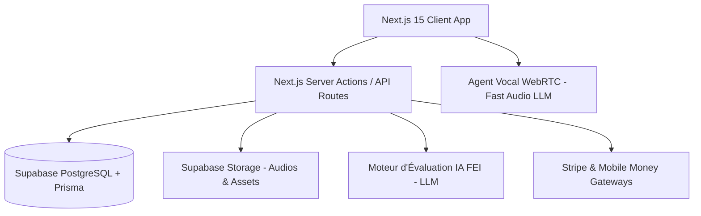

# System Patterns: Super4C2

## 1. Architecture Globale

## 2. Patterns Clés d'Ingénierie & Design Stack
- **Composants d'Élite & Registres UI :**
  - `@magicui` configuré dans `components.json` pour les animations complexes et bento grids.
  - `@react-bits` configuré dans `components.json` pour les arrière-plans animés, textures et visualisations audio.
  - Serveur MCP `21st` et `magicuidesign-mcp` pour la découverte et l'intégration instantanée de composants design.
- **Arborescence & Spécification Maître :**
  - Document de référence : `docs/specs/00-master-product-roadmap.md` (cartographie complète des routes `/examens`, `/dashboard`, `/resultats`, `/oral-ai`, `/tarifs`).
- **Clean Architecture & Domain Separation :**
  - `lib/modules/exam-engine/` : Logique de simulation CBT (questions, timers, scoring).
  - `lib/modules/ai-evaluator/` : Pipeline de correction FEI pour l'écrit et l'oral.
  - `lib/modules/crs-calculator/` : Algorithme officiel de calcul des points NCLC et CRS Canada.
  - `lib/modules/srs/` : Algorithme de répétition espacée pour le carnet d'erreurs.
- **State Management Examen :**
  - Sauvegarde locale automatique (Local Storage / IndexedDB + synchro serveur) pour empêcher toute perte de données en cours d'épreuve.
- **Grille Officielle France Éducation International (FEI) :**
  - Toutes les corrections d'expressions sont pondérées selon les critères officiels :
    * Adéquation à la consigne & volume textuel
    * Cohérence & organisation des idées (connecteurs)
    * Compétence lexicale (étendue et précision)
    * Compétence morphosyntaxique (grammaire, modes, temps)
